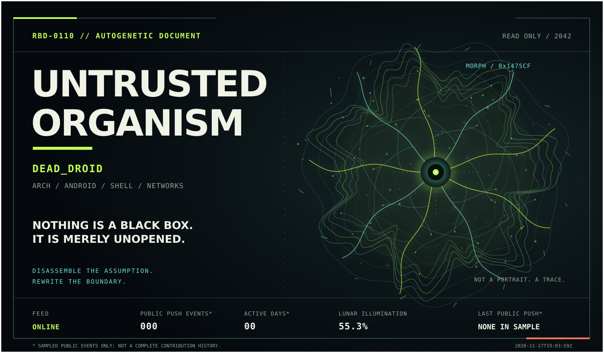

<!--
  ENTITY: RBD-0110
  CLASSIFICATION: UNTRUSTED / AUTOGENERATIVE
  THIS DOCUMENT CONTAINS NO PROJECT INVENTORY.
  The specimen is re-synthesized by .github/workflows/reconstitute.yml.
-->



```text
[AXIOM 00] Nothing is a black box. It is merely unopened.
[AXIOM 01] Permission is not the same thing as trust.
[AXIOM 02] When a system says "impossible", inspect the boundary.
[AXIOM 03] The organism is rebuilt, never finished.
```

<details>
<summary>▸ DISSECTION RECORD / HOW THE ORGANISM MOVES</summary>

```text
SPECIMEN : RBD-0110
FEED     : public GitHub event metadata; never repository names
CYCLE    : UTC / 00:17 · 06:17 · 12:17 · 18:17 (best effort)
PHASE    : calculated lunar illumination (approximate, offline)
MORPHOLOGY : SHA-256 seeded geometry + public push activity
FALLBACK : preserve last good sample; identify feed failure
SECRETS  : none exported to the image
```

The apparatus consists of [`scripts/synthesize.py`](./scripts/synthesize.py) and [the six-hour workflow](./.github/workflows/reconstitute.yml). The image is a sampled record, not a live connection.

</details>