<!-- THE FILE IS NOT THE PORTRAIT. THE FILE IS THE SENSOR. -->

<div align="left">







</div>

<details>
<summary>▸ ACCESS THE BLACK BOX / DECONSTRUCTION PROTOCOL</summary>

```text
rbd@unknown:~$ cat /proc/self/identity
E:IDENTITY_NOT_FOUND

rbd@unknown:~$ fsck /dev/assumptions
[01] Defaults are unexamined decisions.
[02] An error message is a map of a boundary.
[03] Disassemble the assumption, not the evidence.

rbd@unknown:~$ systemctl status specimen
● rbd-0110.service — a periodic refusal to be summarized
   Source: sampled, public GitHub events
   Shape: mathematical; never a downloaded image
   Phase: approximate lunar cycle
   Window: UTC / every six hours, schedule best-effort
   Exposure: no repository names, no private contribution data
   State: synthesized, not streaming
```

`git show --format=fuller` → [the synthesis engine](./scripts/synthesize.py) · [regeneration contract](./.github/workflows/reconstitute.yml)

</details>

<!-- RBD/0110 // eof // STATIC IS A FAILURE MODE -->